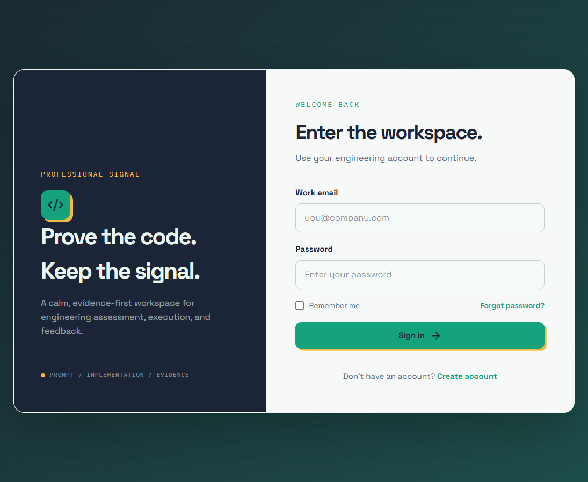
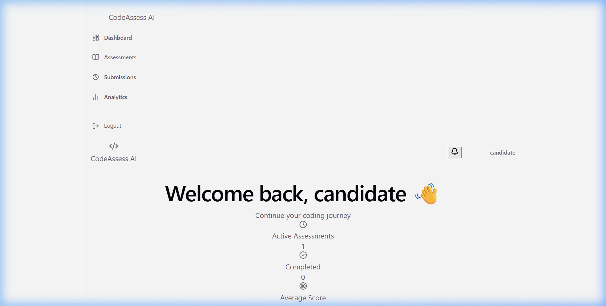
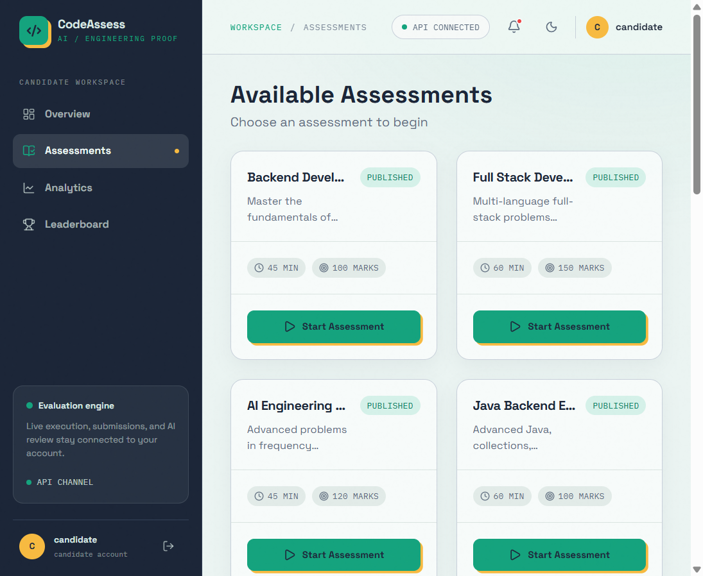
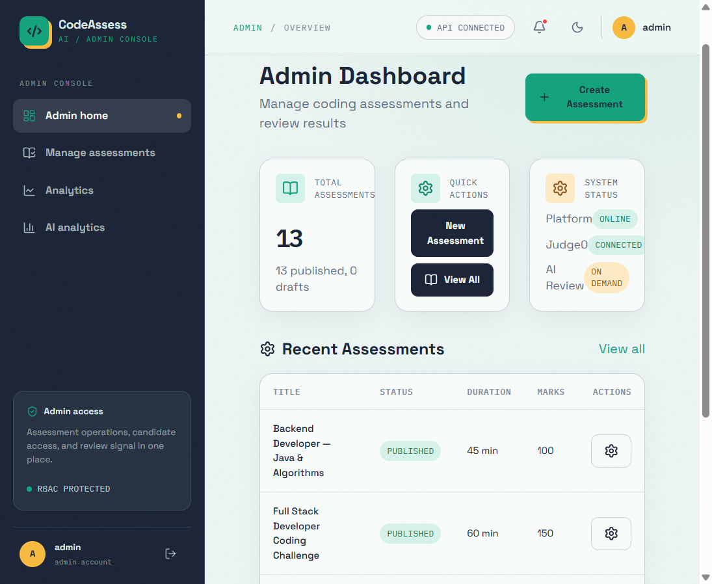
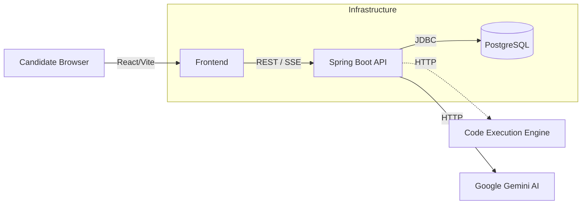

# CodeAssess AI

A full-stack, AI-powered coding assessment platform for automated technical interviews and evaluations.

## Demo

**Live Demo**: Not currently deployed.

**Demo Credentials**:
| Role | Email | Password |
|------|-------|----------|
| Admin | `admin@codeassess.local` | `AdminSecure123` |
| Candidate | `candidate@codeassess.local` | `CandidatePass123` |

*(Demo accounts with seeded assessment data — safe for public demo use.)*

## Screenshots

| Login | Candidate Dashboard |
|-------|-------------------|
|  |  |

| Assessments List | Admin Dashboard |
|------------------|----------------|
|  |  |
## Features


- **Role-based Authentication**: Secure JWT-based access for Admin and Candidate roles.
- **Assessment Management**: Create, manage, and assign multi-problem assessments.
- **Monaco Coding Editor**: Feature-rich, in-browser code editor with syntax highlighting.
- **Timed Assessments**: Real-time evaluation with strict timer constraints.
- **Code Execution**: Integrated code compilation and evaluation.
- **Automated Test-Case Evaluation**: Supports both public and hidden test cases.
- **Real-time Submission Updates**: Server-Sent Events (SSE) for live submission tracking.
- **AI Code Review**: Automated code quality, complexity, and security reviews.
- **Analytics & Leaderboards**: Comprehensive insights into candidate performance.
- **Dockerized Development**: Containerized frontend, backend, and database environments.
- **Infrastructure as Code**: Terraform configuration for AWS deployment.

## Architecture



## Tech Stack

- **Frontend**: React, TypeScript, Vite, Monaco Editor, Vanilla CSS
- **Backend**: Java 25, Spring Boot 3
- **Database**: PostgreSQL 18, Flyway Migrations
- **Execution Engine**: Mocked evaluation (Judge0 compatible)
- **AI Integration**: Google Gemini 2.0 Flash
- **DevOps**: Docker, Docker Compose, Terraform, AWS

## Core Workflow

1. Candidate selects an assigned assessment.
2. Candidate writes code in the React/Monaco workspace.
3. Code is sent to the Spring Boot backend.
4. Backend routes execution to the Evaluation Engine.
5. Live updates stream back via Server-Sent Events (SSE).
6. Upon completion, Google Gemini generates a deep-dive AI Code Review.

## Security

- **Authentication**: JWT stateless authentication with BCrypt password hashing.
- **Authorization**: RBAC (Role-Based Access Control) isolating candidates and admins.
- **Data Privacy**: Complete candidate isolation (cannot access other submissions).
- **Hidden Tests**: Test cases executed server-side, preventing client exposure.
- **Secret Management**: Environment-based secrets (no hardcoded keys in source).

## Testing

- **Backend**: 79 tests passing on Java 25 (JUnit 5 + Mockito).
- **Frontend**: Fully typed TypeScript, 0 Linting Errors.
- **CI/CD**: Prepared for automated GitHub Actions workflows.

## Local Setup

### Prerequisites
- Docker and Docker Compose
- Git

### Installation

1. Clone the repository:
   ```bash
   git clone https://github.com/raunakthakur1909/codeassess-ai.git
   cd codeassess-ai
   ```

2. Copy the example environment variables:
   ```bash
   cp .env.example .env
   ```
   *(Add your `AI_API_KEY` to enable live Gemini reviews).*

3. Start the application:
   ```bash
   docker compose up -d
   ```

### Accessing the Application

- **Frontend**: [http://localhost](http://localhost)
- **Backend API**: `http://localhost:8080/api`
- **Health Check**: `http://localhost:8080/actuator/health`

## Project Structure

```
codeassess-ai/
├── backend/          # Java 25 / Spring Boot application
├── frontend/         # React / TypeScript application
├── infra/            # Terraform AWS infrastructure files
├── db/               # (Optional) Database dump/seed files
├── .github/          # CI/CD workflows
└── docker-compose.yml
```

## Known Limitations

- **Code Execution**: The current demo environment uses a mocked execution engine to guarantee stability without heavy system requirements. Live execution requires configuring a real Judge0 server and updating the `.env`.
- **AI Review**: Real AI reviews require a valid Google Gemini API key. Without one, reviews will fail to process.
- **Production Readiness**: Requires updated JWT secrets, strong database passwords, and HTTPS configuration before deploying to a public server.
