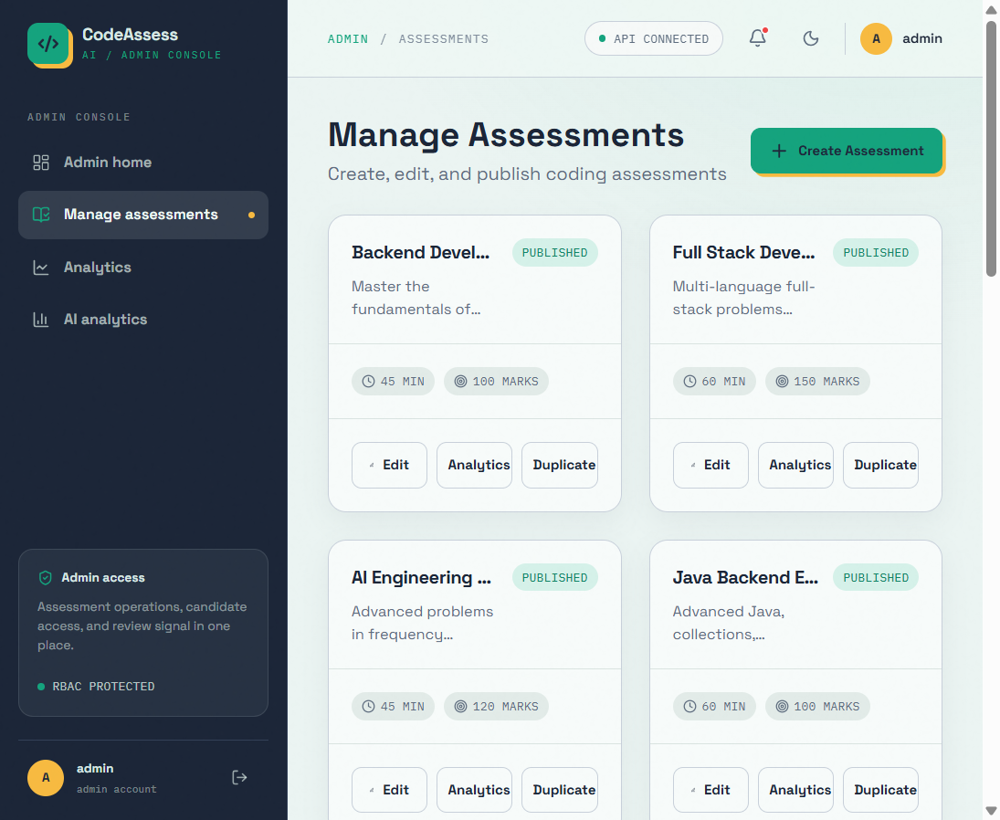

# CodeAssess AI

<p align="center">
  
</p>

<p align="center">
  <strong>Full-Stack Prototype for Technical Assessments and AI-Assisted Code Review</strong>
</p>

<p align="center">
  
  
  
  
  
  
  
  
  
  
</p>

---

## 📌 Overview

**CodeAssess AI** is a full-stack coding assessment platform designed for technical hiring and developer evaluations. It combines real-time code execution, live Server-Sent Events (SSE) telemetry, and AI-assisted code reviews that analyze algorithmic efficiency, security vulnerabilities, edge-case resilience, and code quality.

---

## 📸 Screenshots

| Candidate Dashboard | Available Assessments |
|:---:|:---:|
|  |  |

| Admin Dashboard | Manage Assessments |
|:---:|:---:|
|  |  |

| Sign In |
|:---:|
|  |

---

## ✨ Key Features

### 🤖 Intelligent AI Code Mentor
- **Comprehensive Rubric Evaluation**: Analyzes time & space complexity ($O(N)$, $O(1)$, etc.), algorithmic strengths, optimization targets, and security edge cases.
- **Gemini Provider Fallback**: Tries configured Gemini model alternatives after upstream request failures. Live reviews require a valid API key; set `AI_PROVIDER=mock` for deterministic local review responses.
- **Interactive Review Tabs**:
  - **Overview**: Overall score, executive summary, time/space complexity, strengths, and suggestions.
  - **Diagnose Failures**: Root-cause analysis on failing test cases.
  - **Fix Code**: AI-suggested bug fixes with side-by-side explanations.
  - **Optimize**: Algorithmic and memory optimization guidance.
  - **Edge Cases**: AI-generated boundary test cases to stress-test candidate implementations.

### ⚡ Code Workspace & Real-Time Telemetry
- **Monaco Code Editor**: Professional in-browser IDE experience with syntax highlighting, line numbers, and theme toggling.
- **Multi-Language Support**: Java, Python, C++, C, JavaScript, and Go.
- **Server-Sent Events (SSE)**: Streams submission status updates to the candidate workspace; the current mock worker emits completion events rather than real test progress.
- **Submission Evaluation**: The current development worker is a mock and marks queued submissions accepted; Judge0 integration is not yet wired into the worker. Do not use this evaluator for real assessments.
- **Autosave Drafts**: Real-time debounce synchronization of code drafts so candidates never lose progress.

### 📊 Performance Analytics & Leaderboards
- **Candidate Analytics**: Visual breakdown of acceptance rates, score distribution, submission histories, and complexity trends.
- **Topic Mastery & Weakness Detection**: Highlights areas where candidates excel or require improvement.
- **Global Leaderboard**: Podium rankings for top performers with overall scores and problem solved counts.

### 🛡️ Security & Administration
- **Role-Based Access Control (RBAC)**: Enforced separation between `ADMIN` and `CANDIDATE` personas.
- **Stateless JWT Security**: High-entropy HMAC-SHA256 signatures with BCrypt password hashing.
- **Candidate Isolation**: Candidates can only access their own submissions and assessments.
- **Timer Enforcement**: Server-enforced assessment durations preventing late submissions.
- **Admin Assessment Studio**: Full CRUD workflows to author assessments, attach problems, and configure test cases.

---

## 🏗️ System Architecture

```mermaid
flowchart TD
    subgraph Client ["Frontend (React 18 + Vite)"]
        UI[Monaco Code Workspace & Dashboards]
        SSE_Client[SSE Stream Listener]
        Auth_State[JWT Context & Storage]
    end

    subgraph Gateway ["Reverse Proxy / Web Server"]
        Nginx[Nginx Container (:80)]
    end

    subgraph Server ["Backend (Spring Boot 4.1 / Java 21 source; Java 25 runtime)"]
        API[REST Controllers]
        Security[Spring Security + JWT Filter]
        SSE_Publisher[SSE Event Publisher]
        ExecService[Mock Submission Worker]
        AIService[AI Review Service]
        FallbackEngine[Domain Fallback Reviewer]
    end

    subgraph Data ["Persistence & Sandbox"]
        Postgres[(PostgreSQL 18)]
        Judge0[Judge0 Execution Engine]
        Gemini[Google Gemini API]
    end

    UI -->|HTTP /api| Nginx
    Nginx -->|Proxy :8080| Security
    Security --> API
    API --> SSE_Publisher
    SSE_Publisher -->|EventStream| SSE_Client
    API --> Postgres
    ExecService -.->|Planned integration| Judge0
    AIService -->|HTTPS| Gemini
    AIService -.->|On Limit / Error| FallbackEngine
```

---

## 🛠️ Technology Stack

| Layer | Technologies |
|---|---|
| **Frontend** | React 18, TypeScript, Vite, Monaco Editor, React Router 6, Lucide Icons, Pure CSS |
| **Backend** | Java 21 source compatibility (Java 25 container runtime), Spring Boot 4.1.0, Spring Security, Spring Data JPA, Flyway |
| **Database** | PostgreSQL 18, HikariCP Connection Pooling |
| **AI Integration** | Google Gemini Generative AI REST API (`gemini-flash-latest`) |
| **Code Execution** | Development mock worker; Judge0 client exists but is not connected to the worker |
| **DevOps & Containers** | Docker, Docker Compose, Multi-stage Dockerfiles, Nginx Alpine |
| **Cloud & IaC** | Terraform, AWS ECS (Fargate), AWS RDS PostgreSQL, AWS ALB, SSM Parameter Store |

---

## 🚀 Quick Start (Docker Compose)

The easiest way to launch the entire platform (Frontend, Backend, and PostgreSQL) is with Docker Compose.

### 1. Prerequisites
- [Docker Desktop](https://www.docker.com/products/docker-desktop/) installed and running
- [Git](https://git-scm.com/)

### 2. Clone Repository
```bash
git clone https://github.com/raunakthakur1909/codeassess-ai.git
cd codeassess-ai
```

### 3. Configure Environment Variables
Copy `.env.example` to `.env`:
```bash
cp .env.example .env
```
*(Optional)* Add your Google Gemini API key in `.env` to enable real-time generative reviews:
```env
AI_API_KEY=your_gemini_api_key_here
```
> **Note**: Live Gemini reviews require a valid API key. To try the deterministic local review provider without an API key, set `AI_PROVIDER=mock` in `.env` before starting the stack.

### 4. Build and Run
```bash
docker compose up --build -d
```

### 5. Access the Platform
- **Frontend App**: [http://localhost](http://localhost)
- **Backend API**: [http://localhost:8080/api](http://localhost:8080/api)
- **Actuator Health**: [http://localhost:8080/actuator/health](http://localhost:8080/actuator/health)

---

## 🔑 Local Demo Credentials

The `dev` profile seeds sample data and accounts for local exploration. These fixed credentials are for local development only and must not be used in a deployed environment:

| Role | Email | Password | Permissions |
|---|---|---|---|
| **Admin** | `admin@codeassess.local` | `AdminSecure123` | Assessment authoring, problem management, system analytics |
| **Candidate** | `candidate@codeassess.local` | `CandidatePass123` | Code workspace, assessments, submissions, AI mentor review |

---

## 💻 Local Development Setup (Without Docker)

### Backend (Spring Boot)
1. Ensure **Java 21** and **Maven 3.9+** are installed. The Docker image and CI use JDK/JRE 25 while compiling for Java 21 compatibility.
2. Start a local PostgreSQL instance on port `5432` with database `codeassess_ai`.
3. Navigate to the backend directory:
   ```bash
   cd backend
   ```
4. Run the application:
   ```bash
   ./mvnw spring-boot:run -Dspring-boot.run.profiles=dev
   ```

### Frontend (React + Vite)
1. Ensure **Node.js 20+** is installed.
2. Navigate to the frontend directory:
   ```bash
   cd frontend
   ```
3. Install dependencies:
   ```bash
   npm install
   ```
4. Start the Vite development server:
   ```bash
   npm run dev
   ```
   Open [http://localhost:5173](http://localhost:5173) in your browser.

---

## ⚙️ Environment Variables Reference

| Variable | Description | Default / Example |
|---|---|---|
| `POSTGRES_DB` | PostgreSQL database name | `codeassess_ai` |
| `POSTGRES_USER` | PostgreSQL superuser | `codeassess` |
| `POSTGRES_PASSWORD` | PostgreSQL password | `codeassess_secret_change_me` |
| `SPRING_DATASOURCE_URL` | JDBC database connection string | `jdbc:postgresql://postgres:5432/codeassess_ai` |
| `SPRING_DATASOURCE_USERNAME` | Spring datasource username | `codeassess` |
| `SPRING_DATASOURCE_PASSWORD` | Spring datasource password | `codeassess_secret_change_me` |
| `JWT_SECRET` | Base64 HMAC secret key (>= 32 chars) | Random 64-char string |
| `ADMIN_BOOTSTRAP_ENABLED` | Auto-seed admin user on startup | `true` |
| `ADMIN_BOOTSTRAP_EMAIL` | Bootstrap admin email | `admin@codeassess.local` |
| `ADMIN_BOOTSTRAP_PASSWORD` | Bootstrap admin password | `AdminSecure123` |
| `AI_REVIEW_ENABLED` | Toggle automated AI review processing | `true` |
| `AI_PROVIDER` | AI provider (`gemini` or `mock`) | `gemini` |
| `AI_API_KEY` | Google AI Studio Gemini API Key | `AIzaSy...` |
| `AI_MODEL` | Gemini model name | `gemini-flash-latest` |
| `JUDGE0_ENABLED` | Enable external Judge0 code executor | `false` |

---

## 📡 API Overview

| HTTP Method | Endpoint | Description | Access |
|---|---|---|---|
| `POST` | `/api/auth/login` | Authenticate user & issue JWT | Public |
| `POST` | `/api/auth/register` | Register candidate account | Public |
| `GET` | `/api/assessments` | List available assessments | Authenticated |
| `POST` | `/api/assessments` | Create new assessment | Admin |
| `GET` | `/api/assessments/{id}` | Get assessment details & problems | Authenticated |
| `POST` | `/api/assessments/{id}/start`| Start timed assessment attempt | Candidate |
| `POST` | `/api/submissions` | Submit code for full evaluation | Candidate |
| `GET` | `/api/submissions/{id}/events` | SSE stream for submission execution | Candidate / Admin |
| `GET` | `/api/submissions/{id}/ai-review` | Fetch AI code review analysis | Candidate / Admin |
| `GET` | `/api/analytics/candidate/me` | Candidate performance analytics | Candidate |
| `GET` | `/api/analytics/leaderboard` | Global leaderboard rankings | Authenticated |

---

## ☁️ Infrastructure as Code (Terraform)

Production infrastructure files are located under [`infra/`](infra/):
- **VPC & Networking**: Multi-AZ public/private subnets, NAT Gateways, Security Groups ([`networking.tf`](infra/networking.tf))
- **AWS ECS (Fargate)**: Containerized backend and frontend services ([`ecs.tf`](infra/ecs.tf))
- **AWS RDS**: Managed PostgreSQL database instance ([`rds.tf`](infra/rds.tf))
- **Application Load Balancer**: SSL termination and path-based routing ([`alb.tf`](infra/alb.tf))
- **AWS SSM**: Secure parameter store for secrets and keys ([`ssm.tf`](infra/ssm.tf))

---

## 🧪 Testing

### Backend Unit & Integration Tests
```bash
cd backend
./mvnw test
```
- Includes backend tests covering domain models, JWT security filters, submission handlers, and AI prompt generation.

### Frontend Validation & Type Checking
```bash
cd frontend
npm run build
```

---

## 📄 License

This project is licensed under the [MIT License](LICENSE.txt).
